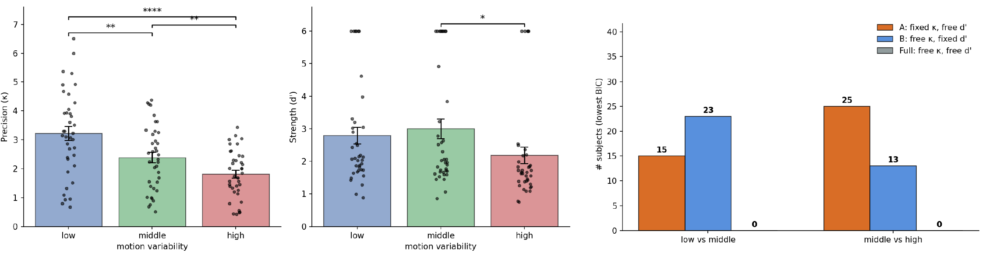
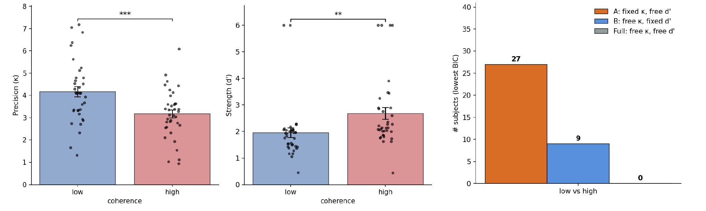

## Hi, I'm Inik Kim (ikim124@ucr.edu)

I am a Ph.D. student in the [Department of Psychology](https://psychology.ucr.edu/) at the **University of California, Riverside**, working in the [Cognitive Neuroscience of Perception, Attention, and Memory Lab](https://memory.ucr.edu/) under the supervision of **Dr. Weiwei Zhang**.

My research broadly focuses on **visual working memory**, **attention**, and **perception**. I am particularly interested in understanding the underlying processes of human cognition and behavior, such as memory using cognitive modeling and advanced data analysis techniques. 

Before joining UCR, I completed my B.A. and M.A. in Psychology at [Jeonbuk National University](https://psy.jbnu.ac.kr/psy/index.do) (South Korea) , where I studied affective neuroscience and psychophysics with Dr. Jongwan Kim and Dr. Chang-Ho Park.

---

## Representative Work

How do memory systems compete, and what determines the quality of a remembered representation? These projects combine behavioral experiments with computational modeling. Select a figure to enlarge it.

:::: {.representative-work}

::: {.research-project}

### Interference between STM and LTM precision

*Kim, Won, Acebo, & Zhang · VSS 2025 conference poster*

Distinguishing similar objects in long-term memory (LTM) can interfere with the precision of information held in short-term memory (STM). In a dual-task experiment, lure discrimination reduced the precision of orientation memory, while the model's memory-success probability showed no detected difference across trial types. These behavioral findings support competition between mnemonic discrimination and STM precision.

{fig-alt="Two bar charts from the VSS 2025 poster. Precision d-prime is lower for lure trials than for target or foil trials. Memory-success probability Pm is similar across the three trial types." .research-figure}

[View VSS 2025 poster](pdfs/VSS2025_Precision_MST_56w_v5.1.pdf)

:::

::: {.research-project}

### Separating memory strength and precision with random-dot motion

*Kim, Ma, Liu, & Zhang · VSS 2026 conference poster*

Does a less accurate memory reflect a weaker signal or a less precise representation? Using a random-dot motion (RDM) recall task and a modified Target Confusability Competition model, we estimated memory strength (d′) and precision (κ) separately.

**Motion variability:** Increasing directional noise from low to moderate levels reduced precision with little change in strength. At the highest noise level, both estimates worsened.

{fig-alt="Three plots from the VSS 2026 poster. Precision falls as motion variability increases; strength changes little from low to moderate variability and falls at high variability. Model comparisons favor changes in precision for the low-to-moderate contrast." .research-figure}

**Motion coherence:** Higher coherence increased strength but decreased the estimated precision. Model comparisons favored a strength-varying, fixed-precision model for 27 of 36 participants. The pattern supports distinct effects of the two noise manipulations, while also showing a trade-off between the fitted parameters.

{fig-alt="Three plots from the VSS 2026 poster. Higher motion coherence lowers estimated precision and raises strength. A model varying strength while fixing precision has the lowest BIC for 27 of 36 participants." .research-figure}

[View VSS 2026 poster](pdfs/VSS2026_TCCk_RDM_v1.5.pdf) · [Analysis code](https://github.com/InikKim/tcck-rdm-vss26)

:::

::::

---

## Research Interests

- Visual Working Memory
- Computational Modeling
- Cognitive Neuroscience
- Attention & Perception
- Affective Neuroscience

---

## Education

**Ph.D. in Psychology** *(2023 – present)*
University of California, Riverside, USA
Advisor: Dr. Weiwei Zhang

**M.A. in Psychology** *(2018 – 2020)*
Jeonbuk National University, South Korea
Advisor: Dr. Chang-Ho Park

**B.A. in Psychology** *(2011 – 2017)*
Jeonbuk National University, South Korea
